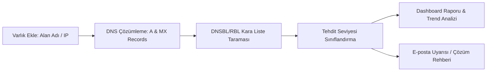

# 🛡️ IP & Domain Reputation Monitor (`ip-reput`)

> **E-posta teslimatınızı ve sunucu itibarınızı koruyun.** Sunucu IP'lerinizi ve alan adlarınızı küresel kara listelerde (RBL / DNSBL) gerçek zamanlı izleyen, tehdit seviyelerini ve itibar geçmişini raporlayan modern itibar denetim platformu.

---

## 📌 Proje Hakkında / Overview

E-posta sunucuları dış dünyaya bağlanırken küresel kara listeler (RBL/DNSBL) sorgulanır. Bir sunucu IP'si veya alan adı geçmiş saldırı, spam veya kötüye kullanım nedeniyle kara listeye alınmışsa e-posta teslimatı sessizce engellenir.

**ip-reput**, alan adlarınızın ve sunucularınızın dış kara listeler tarafından nasıl görüldüğünü tam zamanında tespit eder; risk seviyelerini analiz eder ve listelerden temizleme (delisting) süreçlerini hızlandırır.

*(Bu ürün bir zafiyet tarama aracı değil; **itibar, erişilebilirlik ve e-posta teslimat güvencesi** kontrolüdür).*

---

## ✨ Temel Özellikler / Key Features

- 🔍 **Alan Adı ve IP İzleme:** Alan adı eklendiğinde `A` ve `MX` kayıtları otomatik çözümlenir ve her sorgu döngüsünde DNS değişiklikleri otomatik yansıtılır.
- 🚫 **Kapsamlı Kara Liste (DNSBL/RBL) Taraması:** SMTP teslimatını ve ağ itibarını doğrudan etkileyen harici veri tabanları taranır.
- 🎯 **Akıllı Tehdit Seviyelendirmesi:** PBL (Politika listeleri) ve salt bilgi amaçlı kayıtlar riski şişirmez. Gerçek tehditler önem derecesine göre sınıflandırılır:
  - 🔴 **Kritik:** Aktif saldırı veya zararlı aktivite
  - 🟠 **Yüksek:** Zafiyetli/Spam kaynağı
  - 🟡 **Orta:** Şüpheli etkinlik
  - 🟢 **Düşük:** Bilgi amaçlı
- 📈 **Sorgu Geçmişi ve Trend Analizi:** Listeye yeni eklenen veya temizlenen (delisted) kaynakları zaman ekseninde takip edin.
- ⚡ **Toplu Kontrol & Hızlı Aksiyon:** Tüm varlıklarınızı (alan adı ve IP) tek tıkla toplu olarak denetleyin.
- 🔔 **Bildirimler:** Listelenme tespit edildiğinde veya listeden başarıyla çıkıldığında ilgili ekiplere bildirim.
- 🎨 **Modern Arayüz:** Laravel + Inertia.js (React) ile geliştirilmiş, akıcı ve geliştirici dostu dashboard deneyimi.

---

## 🛠️ Teknoloji Yığını / Tech Stack

- **Backend:** [Laravel](https://laravel.com/) (PHP 8.3+)
- **Frontend:** [Inertia.js](https://inertiajs.com/) & [React](https://react.dev/) / TypeScript
- **Stil & Tasarım:** Modern Minimalist & Emerald UI Token Mimarisi
- **Test:** [Pest PHP](https://pestphp.com/)

---

## 🚀 Kurulum / Getting Started

### Gereksinimler
- PHP `>= 8.3`
- Composer
- Node.js `>= 18` & NPM / PNPM

### Hızlı Kurulum (Ubuntu Otomatik Script)

Tek bir komutla PHP 8.3, Composer, Node.js, Nginx, Supervisor ve Cron yapılandırmasını tamamlamak için:

```bash
git clone https://github.com/moftgate/ip-reput.git
cd ip-reput
sudo bash install.sh --domain panel.sirketiniz.com
```

---

### Manuel Kurulum Adımları

1. **Depoyu klonlayın:**
   ```bash
   git clone https://github.com/moftgate/ip-reput.git
   cd ip-reput
   ```

2. **Bağımlılıkları yükleyin ve ortamı hazırlayın:**
   ```bash
   composer run setup
   ```
   *(Bu komut `composer install`, `.env` kopyalama, `key:generate`, `migrate` ve `npm install` adımlarını otomatik tamamlar).*

3. **Kara liste kaynaklarını yükleyin:**
   ```bash
   php artisan db:seed
   ```

4. **Panel kullanıcısı oluşturun:**
   ```bash
   php artisan iprep:user admin@sirket.com
   ```

5. **Lisansı tanımlayın:** `.env` içine satıcının verdiği `IPREP_LICENSE_PUBLIC_KEY` değerini yazın. Lisans anahtarını paneldeki lisans penceresine girin. Satıcı tarafında anahtar çifti `php artisan iprep:license --keypair`, lisans anahtarı `php artisan iprep:license "Paket" --max-assets=50 --days=365` ile üretilir. Özel anahtar müşteri kurulumuna konmaz.

6. **Geliştirme sunucusunu başlatın:**
   ```bash
   composer run dev
   ```

7. **Üretimde kuyruk ve zamanlayıcıyı çalıştırın:** Sorgular kuyrukta çalışır. Haftalık/aylık sorgular zamanlayıcı ile başlar.
   ```bash
   php artisan queue:work
   # crontab: * * * * * php /yol/artisan schedule:run
   ```
   E-posta uyarıları için `.env` içindeki `MAIL_*` ayarlarını doldurun.

---

## 🧭 Nasıl Çalışır?



1. **Varlık Seçimi:** Doğrulanmış alan adı veya public IPv4 adresi tanımlanır.
2. **DNSBL/RBL Taraması:** Yetkili itibar ve kara liste sağlayıcıları sorgulanır.
3. **Analiz:** Tehdit skorlaması yapılır, önceki sorgularla karşılaştırılarak trend çıkarılır.
4. **Çözüm & Takip:** Kara listeye giriş/çıkış durumları raporlanır ve delisting adımları önerilir.

---

## 📄 Lisans / License

Bu proje [MIT](LICENSE) lisansı altında korunmaktadır.
